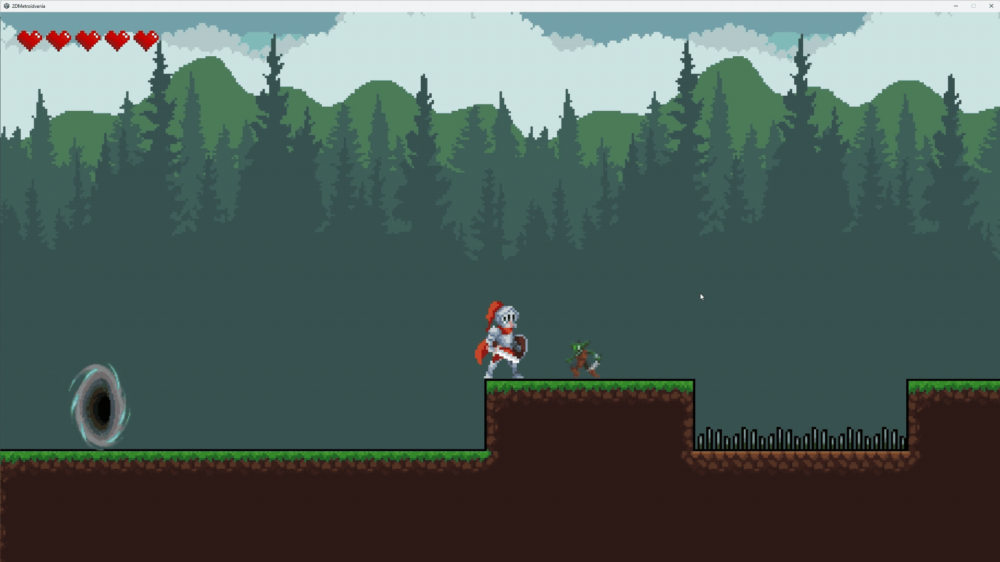

# 👋안녕하세요, 게임 개발과 AI에 관심이 있는 최지웅입니다 

현재 Unity와 C#으로 게임을 개발하고 있습니다.  
실시간 그래픽스와 AI 프로젝트를 통해 구현 경험을 넓혀가고 있습니다.

## 🛠 Tech Stack

**Game & Graphics**

**AI & Backend**

**Tools**

---

## 🎮 Featured Project

### 2D Metroidvania

전투와 탐험을 중심으로 하는 2D 메트로배니아 게임입니다.

  

**주요 구현 기능**
- 플레이어 이동, 점프, 대시
- 일반 공격, 방어, 패링과 연계 반격
- 몬스터 순찰, 추적 및 공격 패턴
- 방 단위 씬 전환과 카메라 추적
- 인벤토리, 퀘스트 및 대화 시스템
- 체크포인트 저장과 이어하기

**개발 과정에서 다룬 문제**
- 물리 충돌과 지면 판정의 안정성
- 전투 상태에 따른 이동·입력·방향 제어
- 애니메이션과 공격 판정의 타이밍

**플레이 영상 링크**

https://youtu.be/sDlo3XeOPmw

---

## 📂 Other Projects

### DirectX 11 Shader Viewer

C++과 HLSL로 구현한 실시간 PBR 셰이더 뷰어입니다.

- HDR 환경맵 기반 IBL과 PBR 재질 전환
- GPU 기반 cubemap 및 BRDF LUT 생성
- Dear ImGui를 이용한 실시간 파라미터 조절과 디버그 뷰

### GSegmenter

3D Gaussian Splatting 장면을 객체 단위로 분리하고
편집하기 위한 연구 프로토타입입니다.

- GroundingDINO와 SAM2를 이용한 객체 마스크 추출
- 멀티뷰 마스크를 3D Gaussian의 객체 정보로 연결
- 객체 그룹 결과의 내보내기와 시각화
- 객체 단위 편집을 위한 기반 모듈 구현

### Moneta — novelbright

초보 웹소설 작가를 위한 AI 집필 보조 서비스입니다.

- Story Keeper: 작품 설정과 내부 개연성 검토
- Clio Fact Checker: 역사 고증과 사실관계 검토
- 회차별 집필 에디터와 캐릭터·플롯·참고 자료 관리

백엔드 구축 및 배포, Clio Fact Checker 에이전트 워크플로우를 담당하였습니다.

